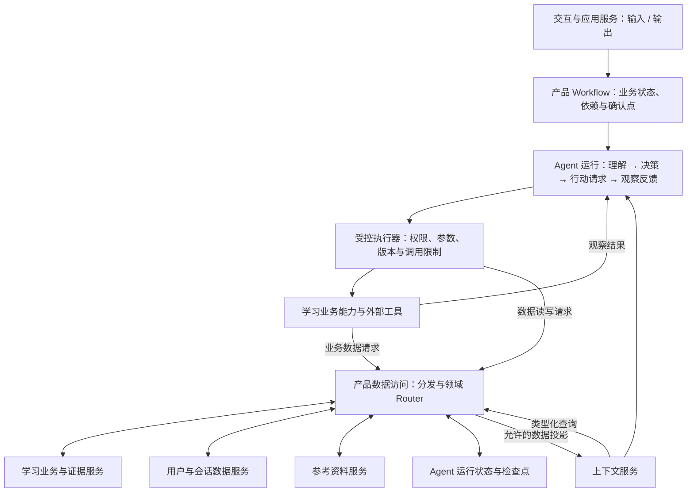

# 产品系统设计：Workflow、Agent 与数据服务

日期：2026-11-01。状态：目标设计，未实现。长期产品形态明确为多人在线；当前交付阶段仍为单用户本机、单 Way 验证，不据此宣布已经支持在线账号、并发或多用户隔离。
产品规则见 [PRD](PRD.md)，实际代码见 [当前架构](architecture.md)。本次设计部分替代旧综合记忆规格的职责分配，保留其来源、版本、恢复和清理要求。

## 1. 六部分主框架

输入、理解、决策、执行、反馈、输出是产品系统的一级职责划分，不对应六个 Agent，也不要求六次模型调用。

| 一级职责 | 内部职责 | 主要所有者 |
|---|---|---|
| 输入 | 接收消息、提交、确认和周期事件；建立请求身份 | 交互适配与应用服务 |
| 理解 | 意图识别、信息提取、明确缺失信息、结合上下文理解问题 | Agent；结构化校验由系统完成 |
| 决策 | 判断业务阶段、形成可行动集合、选择行动和停止条件 | Workflow 提供约束，Agent 作范围内选择 |
| 执行 | 参数/权限/版本复核、调用学习能力与工具 | 受控执行器与业务服务 |
| 反馈 | 校验结果、识别缺口、应用有效业务结果、决定继续或等待 | 确定性规则负责生效，Agent 判断下一行动 |
| 输出 | 生成回答、展示计划和依据、提出问题/请求确认 | Agent 提供表达内容，交互适配器负责呈现 |

产品数据管理与访问层、模型接入和观测在主框架外提供支撑。产品数据按领域所有权管理，并通过各自 Router 控制 Agent 读写；完整矩阵与请求协议见 [产品数据管理与访问设计](data-access-design.md)。

## 2. 数据所有权

| 数据 | 唯一业务所有者 | 其他模块的使用方式 |
|---|---|---|
| 目标、能力矩阵、计划版本、任务、提交、确认与进度 | 学习业务服务 | Agent 通过查询/命令工具使用；不能直接写字段 |
| 判定记录、帮助程度、独立/保持证据、争议与能力画像 | 学习证据与画像服务 | 画像按有效证据规则派生；记忆只引用，不生成替代结论 |
| 偏好、历史对话、接续摘要、过程性的未解决问题 | 用户与会话数据服务 | 按来源准入、任务检索与生命周期管理；任务待办引用业务任务，不另建第二套进度 |
| 文档内容、检索来源、版本及计划采用关系 | 参考资料服务 | 向上下文和学习能力提供来源，不复制成用户能力记忆 |
| run/step、工具结果状态、暂停点、取消和恢复身份 | Agent 运行服务 | 检查点保留恢复必要状态，长期记忆仅接收有后续用途的结果 |
| 调用结果、次数/耗时、评估事件 | 观测与评估服务 | 各调用方提供事件，清理临时记录不抹去评估依据；统计细则另定 |
| 账号身份、访问范围 | 身份与访问控制 | 在线阶段从认证会话产生，不能信任用户或模型提供的 owner_id |

上下文组装是独立读取服务，通过领域 Router 向上述所有者查询；它不保存一份能独立修改的业务事实库。所有上下文子查询和 Agent 主动存取都必须经过对应领域 Router；UserSessionRouter 只处理用户与会话数据，不包揽其他数据权限。
生命周期规则归各数据所有者。跨模块删除由应用服务协调，各所有者返回完成/失败及待处理范围；不能因有四个模块就各删各的，或把部分成功当成彻底删除。

## 3. 接口与单次请求

交互层提交事件，经应用服务协调：识别请求/主体 → 查询 Workflow 快照 → 获取上下文 → Agent 决策 → 执行器复核 → 工具执行 → 业务服务确认生效 → 返回观察 → Agent 继续或输出。
用户确认是独立事件，绑定对象及版本。应用服务不把自然语言中的“模型说已确认”当成授权。业务工具返回有效性、对象版本和实际保存状态；最终回复不能凭模型自述宣称成功。
核心不使用终端 input/print 完成交互协议，而返回结构化的消息、进度、待确认动作与运行状态。CLI、未来 Web 通过同一应用接口使用核心；长操作可流式报告进度，断开页面不等于取消服务端运行。

## 4. 多人在线的演进约束

当前本地入口可注入固定本机主体；接口从现在起携带可信 principal、way_id、request_id、对象版本。在线阶段服务器建立身份，所有业务/记忆/资料采用关系及运行查询必须校验主体所有权；Way ID 不是访问凭据。会话、缓存、检索索引与后台作业同样限定主体和目标。
当前单用户 JSON 只属于本地存储适配器。在线阶段需要支持事务及并发的服务端持久化、用户隔离、作业恢复与独立对象存储等能力；具体数据库/队列/框架另行选型，不能把共享全局 JSON 部署到服务器就视为多人支持。
UI 不直接读取存储、调用模型或修改状态。应用接口负责用户命令，后台工作单元负责较长 Agent 运行；取消、确认、重试需能关联原运行且不重复应用。业务授权和写入规则在线阶段仍是服务端权威。
不在当前原型实现账号、订阅、组织租户或多 Way 管理；这些是后续交付，不影响先建立职责和接口。Python 核心继续保留，界面技术暂不绑定。

## 5. 测试与迁移顺序

先固定跨层命令/事件契约和所有权；将当前执行器中的业务生效规则收敛到业务服务，再将矩阵选择与 Agent 选择分离；拆上下文、记忆、资料、运行检查点；最后替换交互和存储适配器。
不是一次重写所有目录。首先用同一应用入口验证固定工作流与局部 Agent 的业务等价边界，再验证非法确认、重复事件、版本冲突、取消、跨主体访问和数据删除。在线能力尚未实现前，测试拒绝错误主体不等于多用户服务已可发布。
旧 AC-30～35 的行为要求继续有效，按新所有者分配验收；旧综合记忆规格中的统一 MemoryCoordinator 不再作为整个产品的业务/运行/资料总入口。
